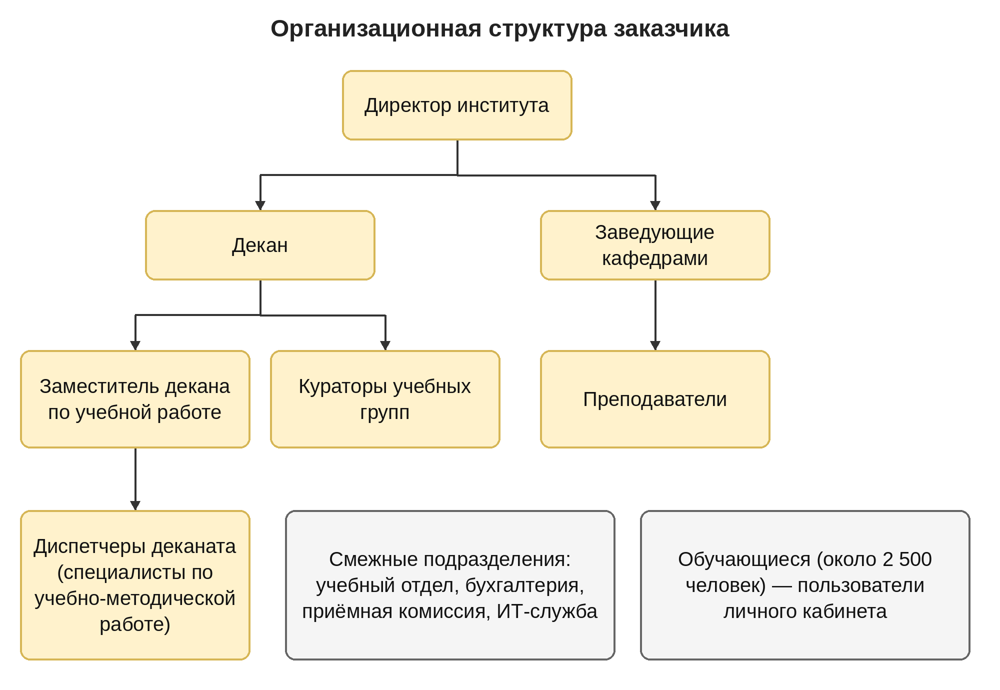
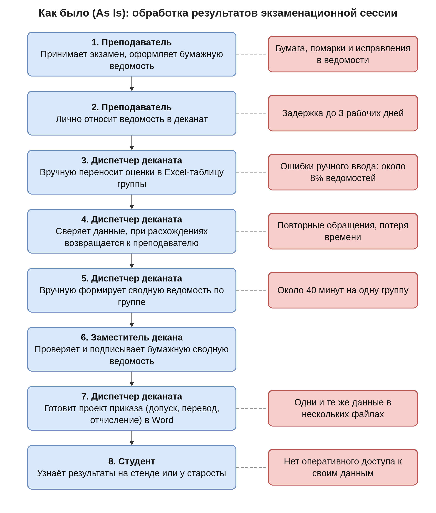
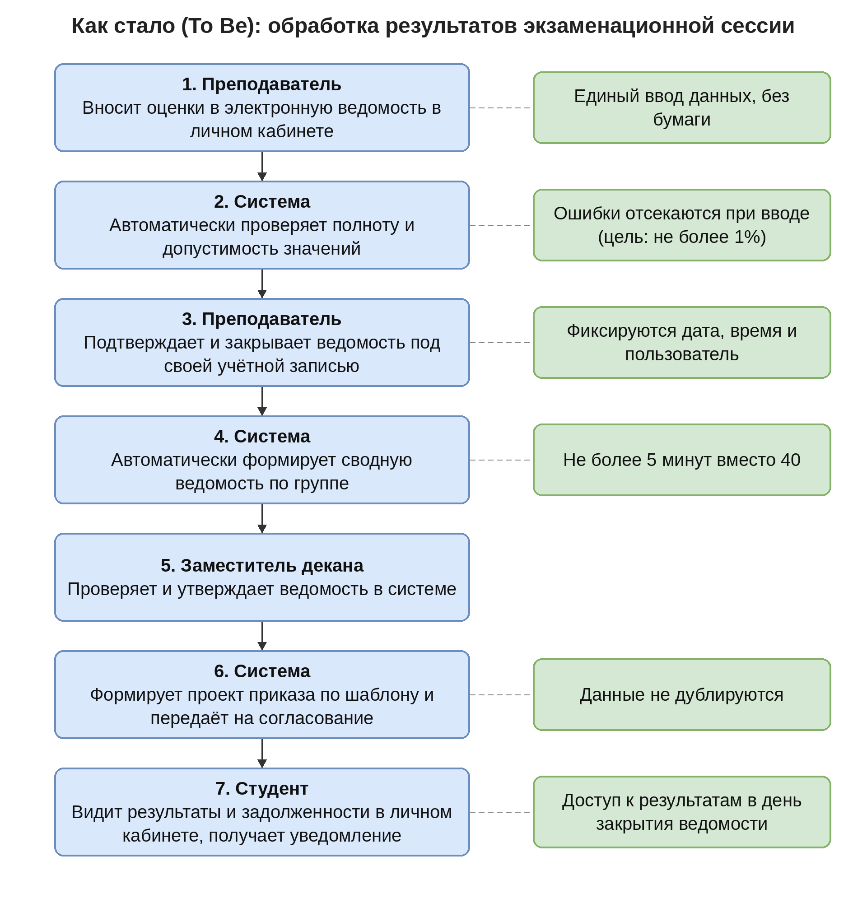

# Отчёт по лабораторной работе №2

**«Разработка технического задания на внедрение информационной системы»**

МДК 04.01 · Рубцовский индустриальный институт (филиал АлтГТУ им. И.И. Ползунова)

Выполнил: студент группы ИСП 11-51 Ельченинов Олег Олегович · Рубцовск, 2026

## ЦЕЛЬ И ЗАДАЧИ РАБОТЫ

**Цель работы:** Сформировать практические навыки разработки технического задания (ТЗ) на внедрение информационной системы в соответствии с требованиями ГОСТ 34.602-89.

Для достижения цели необходимо решить следующие задачи:

1. изучить структуру и содержание ТЗ по ГОСТ 34.602-89;
2. провести анализ бизнес-процессов предприятия-заказчика;
3. сформулировать функциональные и нефункциональные требования к информационной системе;
4. определить требования к техническому обеспечению и подготовке объекта автоматизации;
5. оформить ТЗ в соответствии со стандартом.

## КРАТКОЕ ОПИСАНИЕ ПРЕДПРИЯТИЯ-ЗАКАЗЧИКА

**Вид деятельности и масштаб.** Объектом автоматизации выбран деканат Рубцовского индустриального института (филиала) федерального государственного бюджетного образовательного учреждения высшего образования «Алтайский государственный технический университет им. И.И. Ползунова» (далее – Институт), г. Рубцовск, Алтайский край.

Институт ведёт образовательную деятельность по программам профессионального образования. Для целей работы приняты следующие количественные характеристики: около 2 500 обучающихся, около 150 преподавателей, 10 рабочих мест сотрудников деканата.

**Организационная структура.** Деканат подчиняется директору Института. Работу деканата возглавляет декан; заместитель декана по учебной работе руководит диспетчерами деканата (специалистами по учебно-методической работе). Преподаватели входят в состав кафедр, которыми руководят заведующие. За каждой учебной группой закреплён куратор. Схема структуры приведена в приложении А.

**Бизнес-процессы.** Основные бизнес-процессы деканата:

- учёт контингента (зачисление, перевод, восстановление, отчисление, академический отпуск);
- учёт успеваемости: ведомости, сводные ведомости, выявление задолженностей;
- подготовка проектов приказов (допуск к сессии, перевод, отчисление);
- выдача справок обучающимся;
- подготовка отчётности для администрации Института.

**Текущий уровень автоматизации.** Значительная часть процессов выполняется в таблицах Excel, документах Word и на бумаге. Существующая информационная система «Электронный деканат» устарела и покрывает только часть задач учёта; данные в ней и в файлах сотрудников дублируются.

**Проблемы.** Главные проблемы, которые должно решить внедрение:

1. ручной перенос и дублирование данных приводят к ошибкам: около 8% ведомостей содержат расхождения с данными деканата;
2. отчётность и справки готовятся долго: сводная ведомость по одной группе – около 40 минут, справка об обучении – до 3 рабочих дней;
3. у обучающихся и преподавателей нет оперативного доступа к данным, а файлы с персональными данными хранятся на отдельных компьютерах без разграничения доступа.

Текущий и целевой порядок обработки результатов сессии показан на схемах «Как было» и «Как стало» (приложения Б и В).

## ТЕХНИЧЕСКОЕ ЗАДАНИЕ

**на внедрение автоматизированной информационной системы «Электронный деканат» Рубцовского индустриального института**

### 1. Общие сведения

#### 1.1. Наименование и обозначение системы

Полное наименование – автоматизированная информационная система «Электронный деканат» (версия 2.0). Условное обозначение – АИС «ЭД РИИ». Шифр темы – ЛР2-ЭД-2026.

#### 1.2. Заказчик и исполнитель

Заказчик – Рубцовский индустриальный институт (филиал) ФГБОУ ВО «АлтГТУ им. И.И. Ползунова». Исполнитель – студент группы ИСП 11-51 Ельченинов О.О. (учебный проект).

#### 1.3. Основание для создания системы

Основанием служит задание на лабораторную работу №2 по МДК 04.01 и ГОСТ 34.602-89. Перечень нормативных документов приведён в разделе 9.

#### 1.4. Плановые сроки

Начало работ – 01.12.2026; окончание приёмо-сдаточных испытаний – 30.07.2027; ввод в промышленную эксплуатацию – 01.09.2027; гарантийное сопровождение – до 28.02.2028.

#### 1.5. Источники и порядок финансирования

Работы финансируются за счёт средств Заказчика. В рамках учебной работы стоимость не рассчитывается.

#### 1.6. Порядок оформления и предъявления результатов

Результаты предъявляются Заказчику по этапам, указанным в разделе 5. Каждый этап завершается актом сдачи-приёмки; комплект документов передаётся согласно разделу 8.

**Таблица 1 – Термины и сокращения**

| Сокращение | Расшифровка |
|---|---|
| АИС | автоматизированная информационная система |
| АРМ | автоматизированное рабочее место |
| ЛК | личный кабинет |
| ПДн | персональные данные |
| ПМИ | программа и методика испытаний |
| ПСИ | приёмо-сдаточные испытания |
| ОЭ | опытная эксплуатация |
| СУБД | система управления базами данных |
| RTO | максимально допустимое время восстановления после сбоя |
| RPO | максимально допустимый объём потерянных данных, выраженный во времени |

### 2. Назначение и цели создания системы

#### 2.1. Назначение системы

АИС «ЭД РИИ» предназначена для автоматизации учёта контингента и успеваемости обучающихся, подготовки приказов и справок, информирования обучающихся и формирования отчётности деканата.

#### 2.2. Цели создания системы

Цели сформулированы по методу SMART: каждая конкретна, измерима, достижима, значима для Заказчика и ограничена по времени.

**Таблица 2 – Цели создания системы**

| № | Цель | Показатель (было → должно быть) | Срок |
|---|---|---|---|
| Ц1 | Сократить время формирования сводной ведомости по группе | около 40 мин → не более 5 мин (на 10 группах) | 01.09.2027 |
| Ц2 | Снизить долю ведомостей с расхождениями данных | около 8% → не более 1% (по итогам первой сессии 2027/2028 учебного года) | 28.02.2028 |
| Ц3 | Сократить срок выдачи справки об обучении и перевести заявки в личный кабинет | до 3 рабочих дней → 1 рабочий день; не менее 70% заявок подаётся через ЛК | 31.10.2027 |

#### 2.3. Подсистемы

**Таблица 3 – Подсистемы АИС «ЭД РИИ»**

| Код | Подсистема | Назначение |
|---|---|---|
| П1 | Учёт контингента | карточки обучающихся, движение контингента, импорт, поиск |
| П2 | Учёт успеваемости | электронные ведомости, сводные ведомости, задолженности |
| П3 | Приказы и справки | проекты приказов, заявки и выдача справок, журналы |
| П4 | Личные кабинеты | кабинеты обучающегося и преподавателя, уведомления |
| П5 | Отчётность | отчёты по успеваемости и контингенту, выгрузка в XLSX и PDF |
| П6 | Администрирование и безопасность | учётные записи, роли, журнал аудита, резервное копирование |

### 3. Характеристика объекта автоматизации

Объектом автоматизации является деятельность деканата Института по учёту контингента и успеваемости, оформлению приказов и справок и взаимодействию с обучающимися и преподавателями. Организационная структура показана в приложении А.

**Таблица 4 – Процессы деканата и степень их автоматизации**

| Процесс | Как было (As Is) | Как должно быть (To Be) |
|---|---|---|
| Учёт контингента | таблицы Excel и частично устаревшая ИС; данные дублируются | единая база данных с историей изменений |
| Ведомости и успеваемость | бумажные ведомости, ручной перенос оценок в Excel | электронные ведомости с автоматической проверкой |
| Приказы | ручная подготовка в Word | автоматическое формирование проектов по шаблонам |
| Справки | по личному обращению, до 3 рабочих дней | заявка в личном кабинете, выдача за 1 рабочий день |
| Отчётность | ручной расчёт в Excel | автоматические отчёты, выгрузка в XLSX и PDF |
| Информирование | стенды, старосты групп | личный кабинет и уведомления по электронной почте |

Система эксплуатируется в локальной сети Института; личный кабинет доступен обучающимся и преподавателям из сети Интернет по защищённому протоколу. Деканат работает по рабочим дням; система доступна круглосуточно (гарантированный уровень доступности – в соответствии с п. 4.2).

### 4. Требования к системе

#### 4.1. Требования к функциональным характеристикам

Система состоит из шести подсистем (п. 2.3) и работает в штатном режиме (обработка запросов пользователей), сервисном режиме (обновление и обслуживание вне рабочего времени) и аварийном режиме (восстановление из резервной копии).

**Таблица 5 – Функциональные требования**

| № | Подсистема | Требование |
|---|---|---|
| ФТ-01 | П1 | Система должна обеспечивать возможность создания, редактирования и просмотра карточки обучающегося (ФИО, дата рождения, группа, специальность или направление, форма и основа обучения, статус, контактные данные). |
| ФТ-02 | П1 | Система должна обеспечивать учёт движения контингента (зачисление, перевод, восстановление, отчисление, академический отпуск) с сохранением истории изменений: дата, пользователь, основание. |
| ФТ-03 | П1 | Система должна обеспечивать импорт списков обучающихся из файлов Excel (.xlsx) с проверкой формата и формированием отчёта об ошибках импорта. |
| ФТ-04 | П2 | Система должна предоставлять преподавателю электронную ведомость по дисциплине и группе для ввода результатов (оценка, «зачтено», «не зачтено», «не явился»). |
| ФТ-05 | П2 | Система должна автоматически проверять допустимость введённых значений и полноту ведомости до её закрытия. |
| ФТ-06 | П2 | Система должна обеспечивать закрытие ведомости преподавателем под своей учётной записью с фиксацией даты и времени и блокировкой дальнейшего редактирования без разрешения заместителя декана. |
| ФТ-07 | П2 | Система должна автоматически формировать сводную ведомость успеваемости по группе на основании закрытых ведомостей с выводом на печать и выгрузкой в PDF и XLSX. |
| ФТ-08 | П2 | Система должна автоматически выявлять обучающихся с академической задолженностью и формировать их список по группе и по дисциплине. |
| ФТ-09 | П3 | Система должна автоматически формировать проекты приказов (о допуске к сессии, переводе на следующий курс, отчислении) по утверждённым шаблонам на основании данных ведомостей и карточек обучающихся. |
| ФТ-10 | П3 | Система должна принимать электронные заявки на справки об обучении и после одобрения сотрудником деканата автоматически формировать справку по шаблону. |
| ФТ-11 | П3 | Система должна вести журнал выданных справок и приказов с уникальными номерами и поиском по ФИО, номеру и дате. |
| ФТ-12 | П4 | Система должна предоставлять обучающемуся личный кабинет с просмотром результатов сессии, текущих задолженностей и статуса поданных заявок. |
| ФТ-13 | П4 | Система должна автоматически отправлять обучающемуся уведомления по электронной почте при закрытии ведомости, появлении задолженности и готовности справки. |
| ФТ-14 | П5 | Система должна формировать отчёты об успеваемости по группе, по дисциплине и по преподавателю, а также отчёт о движении контингента за период с выгрузкой в XLSX и PDF. |
| ФТ-15 | П5 | Система должна формировать стандартный отчёт о контингенте на заданную дату за время не более 1 минуты. |
| ФТ-16 | П6 | Система должна обеспечивать управление учётными записями и ролями пользователей (администратор, декан, заместитель декана, диспетчер деканата, преподаватель, обучающийся). |
| ФТ-17 | П1 | Система должна обеспечивать поиск обучающегося по ФИО, номеру зачётной книжки и группе с откликом не более 2 секунд. |

**Таблица 6 – Нефункциональные требования**

| № | Требование |
|---|---|
| НТ-01 | Система должна обеспечивать одновременную работу не менее 200 пользователей без ухудшения времени отклика. |
| НТ-02 | Время отклика на типовые операции (поиск, открытие карточки, ввод оценки) должно быть не более 2 секунд для 95% запросов при нагрузке по НТ-01. |
| НТ-03 | Формирование сводной ведомости по группе должно занимать не более 30 секунд, отчёта о контингенте – не более 1 минуты. |
| НТ-04 | Доступ к системе должен осуществляться через веб-браузер (Chrome, Firefox, Edge, Яндекс Браузер – две последние версии); интерфейс на русском языке, пригодный для просмотра со смартфона. |
| НТ-05 | Преподаватель после обучения в течение 1 часа должен самостоятельно вводить и закрывать ведомость (проверяется на 5 преподавателях без подсказок). |

#### 4.2. Требования к надёжности

**Таблица 7 – Показатели надёжности**

| Показатель | Требование |
|---|---|
| Коэффициент готовности | не менее 99% в режиме 08:00–20:00 с понедельника по субботу (не более 3 часов простоя в месяц) |
| Время восстановления после сбоя (RTO) | не более 4 часов |
| Допустимая потеря данных (RPO) | не более 4 часов |
| Резервное копирование | полная копия БД ежедневно в 02:00; копирование журналов транзакций не реже 1 раза в 4 часа |
| Хранение копий | 30 суток; одна копия на отдельном от сервера носителе; копии шифруются |
| Проверка восстановления | не реже 1 раза в квартал |
| Плановые остановки | только вне рабочего времени (воскресенье 02:00–06:00) с предупреждением пользователей за 1 рабочий день |
| Допустимое время простоя | одного сбоя – не более 4 часов |
| Защита от сбоев питания и дисков | источник бесперебойного питания (работа сервера не менее 30 минут); зеркалирование дисков (RAID 1) |
| Целостность данных | транзакционная обработка; закрытые ведомости не удаляются, а только аннулируются с записью в журнал |

#### 4.3. Условия эксплуатации

**Таблица 8 – Пользователи системы и требования к их подготовке**

| Роль | Число | Квалификация | Обучение |
|---|---|---|---|
| Администратор | 1–2 | навыки администрирования Linux и СУБД | 16 ч |
| Декан, заместитель декана | около 3 | уверенный пользователь ПК | 4 ч |
| Диспетчер деканата | 10 | уверенный пользователь ПК, знание процессов деканата | 8 ч |
| Преподаватель | около 150 | базовые навыки работы в браузере | 2 ч и видеоинструкция |
| Обучающийся | около 2 500 | базовые навыки работы в браузере | не требуется (инструкция в ЛК) |

Режим работы: круглосуточный; гарантированная техническая поддержка – с 08:00 до 20:00 с понедельника по субботу. Сервер размещается в помещении с температурой +18…+27 °C и влажностью 20–80% без конденсации.

#### 4.4. Требования к составу и параметрам технических средств

**Таблица 9 – Технические средства**

| Компонент | Минимальные требования |
|---|---|
| Сервер (допускается виртуальная машина) | не менее 4 vCPU (x86-64), 16 ГБ ОЗУ, SSD 256 ГБ в RAID 1, сетевой адаптер 1 Гбит/с |
| Хранилище резервных копий | не менее 1 ТБ, отдельное от сервера устройство |
| Источник бесперебойного питания | не менее 1 кВА, автономная работа сервера не менее 30 мин |
| АРМ деканата (10 шт.) | 4 ядра ЦП, 8 ГБ ОЗУ, монитор 1920×1080, Windows 10/11 или Linux, современный браузер |
| АРМ преподавателя и обучающегося | любое устройство с браузером (ПК, ноутбук, смартфон) |
| Периферия | лазерные принтеры A4 с двусторонней печатью – 3 шт.; сканеры A4 с автоподатчиком – 2 шт.; терминалы сбора данных не требуются |
| Сетевое оборудование | локальная сеть не ниже 100 Мбит/с до АРМ и 1 Гбит/с до сервера; внешний канал не менее 50 Мбит/с; межсетевой экран |
| Серверное ПО | Linux (Ubuntu Server 24.04 LTS или Astra Linux Special Edition – по решению Заказчика), СУБД PostgreSQL 15 и выше, веб-сервер с поддержкой HTTPS |

#### 4.5. Требования к информационной и программной совместимости

- импорт и экспорт данных в форматах XLSX и CSV (UTF-8); печатные формы – PDF; шаблоны приказов и справок – DOCX;
- СУБД – PostgreSQL версии 15 и выше, кодировка UTF-8;
- отправка уведомлений через почтовый сервер Института по протоколу SMTP;
- учётные записи – собственная аутентификация системы с возможностью перехода на каталог LDAP или Active Directory (по решению Заказчика);
- программный интерфейс (REST, формат JSON, протокол HTTPS) для будущей интеграции с информационными системами университета;
- перенос данных из существующей ИС «Электронный деканат» и файлов Excel за последние 5 лет: все обязательные поля переносятся без потерь, выборочная сверка не менее 10% записей не выявляет расхождений;
- клиентская часть не требует установки программ на АРМ.

#### 4.6. Требования к защите информации

Система обрабатывает персональные данные обучающихся и работников и является информационной системой персональных данных. Уровень защищённости определяется на этапе проектирования в соответствии с постановлением Правительства РФ № 1119 и приказом ФСТЭК России № 21.

- аутентификация по логину и паролю: пароль не короче 10 символов, хранение только в виде криптографических хэшей с солью, смена пароля при первом входе; блокировка учётной записи на 15 минут после 5 неудачных попыток входа; двухфакторная аутентификация для администратора и декана;
- автоматическое завершение сеанса после 30 минут бездействия;
- передача данных только по протоколу HTTPS (TLS 1.2 и выше);
- протоколирование: вход и выход, неудачные попытки входа, создание, изменение и удаление оценок, приказов и справок с указанием пользователя, времени, IP-адреса и прежнего значения; журнал недоступен для редактирования и хранится не менее 1 года;
- разграничение прав доступа по ролям согласно таблице 10.

**Таблица 10 – Права доступа ролей**

| Роль | Права |
|---|---|
| Администратор | управление учётными записями и настройками, резервное копирование; доступа к редактированию оценок нет |
| Декан, заместитель декана | просмотр всех данных, утверждение ведомостей и приказов, разблокировка закрытых ведомостей |
| Диспетчер деканата | ведение контингента, обработка заявок на справки, формирование отчётов |
| Преподаватель | только свои дисциплины и группы: ввод и закрытие ведомостей |
| Обучающийся | только собственные данные: результаты, задолженности, заявки |

### 5. Состав и содержание работ по созданию системы

**Таблица 11 – Этапы работ**

| № | Этап | Содержание | Сроки | Результат |
|---|---|---|---|---|
| 1 | Обследование | интервью с сотрудниками деканата, описание процессов As Is, уточнение требований | 01.12.2026 – 25.12.2026 | отчёт об обследовании, согласованные требования |
| 2 | Проектирование | модель To Be, модель данных, прототипы интерфейсов, матрица ролей | 11.01.2027 – 19.02.2027 | технический проект |
| 3 | Разработка и настройка | реализация подсистем П1–П6, тестовая среда, пробная загрузка данных | 22.02.2027 – 30.04.2027 | программное обеспечение, ПМИ |
| 4 | Внедрение и обучение | развёртывание на сервере Заказчика, перенос данных, обучение пользователей | 04.05.2027 – 11.06.2027 | работающая система, акты об обучении |
| 5 | Опытная эксплуатация | работа в реальных условиях (летняя сессия), устранение замечаний | 15.06.2027 – 16.07.2027 | протокол опытной эксплуатации |
| 6 | Приёмо-сдаточные испытания | испытания по ПМИ, оформление результатов | 19.07.2027 – 30.07.2027 | протокол ПСИ, акт приёмки |
| 7 | Эксплуатация и гарантийное сопровождение | ввод в промышленную эксплуатацию, исправление дефектов, консультации | с 01.09.2027 до 28.02.2028 | отчёт о достижении целей Ц1–Ц3 |

### 6. Порядок контроля и приёмки системы

#### 6.1. Виды испытаний

**Таблица 12 – Виды испытаний**

| Вид | Где и как проводится | Что проверяется |
|---|---|---|
| Предварительные | на тестовой среде Исполнителя по ПМИ | функциональные требования ФТ-01 – ФТ-17, права доступа |
| Опытная эксплуатация | на сервере Заказчика с реальными данными не менее 30 календарных дней | работа в реальных условиях, нагрузка, удобство, отсутствие критических отказов |
| Приёмо-сдаточные | на сервере Заказчика по ПМИ в присутствии комиссии | соответствие ТЗ, достижение показателей Ц1–Ц3, восстановление из копии |

#### 6.2. Критерии успешного завершения

- все требования ФТ и НТ выполнены; открытых дефектов критического и высокого уровня нет; открытых дефектов среднего уровня не более 5 с согласованным планом устранения;
- сводная ведомость формируется не более чем за 5 минут на не менее чем 10 группах (цель Ц1);
- нагрузочный тест на 200 одновременных пользователей: 95% откликов не более 2 секунд;
- восстановление из резервной копии выполнено за время не более 4 часов;
- перенос данных: обязательные поля перенесены полностью, выборочная сверка 10% записей без расхождений;
- негативные тесты прав доступа подтверждают, что пользователь не видит и не изменяет данные вне своей роли;
- опытная эксплуатация продолжалась не менее 30 календарных дней без критических отказов.

#### 6.3. Состав приёмочной комиссии

Председатель – директор Института или назначенный им заместитель. Члены комиссии: декан; заместитель декана по учебной работе; руководитель ИТ-службы; представитель учебного отдела; ответственный за обработку и защиту персональных данных. Представитель Исполнителя участвует с правом совещательного голоса.

#### 6.4. Оформление результатов

По результатам испытаний составляются протокол и ведомость замечаний. После устранения замечаний комиссия подписывает акт приёмки системы в эксплуатацию.

### 7. Требования к подготовке объекта автоматизации

**Таблица 13 – Мероприятия Заказчика по подготовке объекта**

| № | Мероприятие | Ответственный | Срок |
|---|---|---|---|
| 7.1 | Назначить приказом руководителя проекта со стороны деканата и администратора системы | директор Института | до 25.12.2026 |
| 7.2 | Утвердить регламент работы с ведомостями (оценки вносятся не позднее 2 рабочих дней после экзамена), шаблоны приказов и справок | заместитель декана | до 19.02.2027 |
| 7.3 | Актуализировать документы по обработке ПДн (политика, перечень данных, согласия обучающихся); утвердить перечень лиц с доступом и их роли | ответственный за ПДн | до 30.04.2027 |
| 7.4 | Подготовить сервер (или виртуальную машину) по п. 4.4, установить ОС и СУБД | ИТ-служба | до 30.04.2027 |
| 7.5 | Выделить IP-адрес и доменное имя, получить сертификат TLS, настроить доступ к ЛК из Интернета через межсетевой экран | ИТ-служба | до 30.04.2027 |
| 7.6 | Подготовить хранилище резервных копий и источник бесперебойного питания | ИТ-служба | до 30.04.2027 |
| 7.7 | Привести исходные данные в порядок: актуализировать списки обучающихся, учебные планы, справочники групп и дисциплин (по шаблону Исполнителя в Excel) | диспетчеры деканата | до 30.04.2027 |
| 7.8 | Подготовить компьютерный класс на 12 мест с доступом к тестовой среде; обеспечить АРМ деканата принтерами и сканерами | ИТ-служба | до 04.05.2027 |
| 7.9 | Обеспечить явку на обучение: преподаватели группами по 15–20 человек, диспетчеры деканата | заместитель декана | 04.05.2027 – 11.06.2027 |

### 8. Требования к документированию

Документы передаются Заказчику в электронном (PDF, DOCX) и бумажном виде на русском языке:

**Таблица 14 – Перечень передаваемых документов**

| Документ | Назначение |
|---|---|
| Руководство администратора | установка, настройка, управление учётными записями, резервное копирование и восстановление |
| Руководства пользователя (преподавателя, диспетчера деканата, обучающегося) | порядок выполнения операций в системе |
| Описание программы | архитектура, модель данных, интерфейсы |
| Программа и методика испытаний | перечень проверок и критерии приёмки |
| Протоколы опытной эксплуатации и ПСИ, акт приёмки | подтверждение выполнения требований ТЗ |
| Описание модели ролей и матрицы доступа | права каждой роли |
| Исходные коды с инструкцией по сборке и развёртыванию | сопровождение системы силами Заказчика |

### 9. Источники разработки

1. ГОСТ 34.602-89. Информационная технология. Комплекс стандартов на автоматизированные системы. Техническое задание на создание автоматизированной системы.
2. ГОСТ 34.601-90. Информационная технология. Комплекс стандартов на автоматизированные системы. Автоматизированные системы. Стадии создания.
3. ГОСТ 34.201-89. Информационная технология. Комплекс стандартов на автоматизированные системы. Виды, комплектность и обозначение документов при создании автоматизированных систем.
4. РД 50-34.698-90. Автоматизированные системы. Требования к содержанию документов.
5. ГОСТ Р ИСО/МЭК 25010-2015. Информационные технологии. Системная и программная инженерия. Требования и оценка качества систем и программного обеспечения (SQuaRE). Модели качества систем и программных продуктов.
6. Федеральный закон от 29.12.2012 № 273-ФЗ «Об образовании в Российской Федерации».
7. Федеральный закон от 27.07.2006 № 152-ФЗ «О персональных данных».
8. Федеральный закон от 27.07.2006 № 149-ФЗ «Об информации, информационных технологиях и о защите информации».
9. Постановление Правительства РФ от 01.11.2012 № 1119 «Об утверждении требований к защите персональных данных при их обработке в информационных системах персональных данных».
10. Приказ ФСТЭК России от 18.02.2013 № 21 «Об утверждении Состава и содержания организационных и технических мер по обеспечению безопасности персональных данных при их обработке в информационных системах персональных данных».
11. Задание на лабораторную работу №2 по МДК 04.01 «Разработка технического задания на внедрение информационной системы».

## ВЫВОДЫ

В ходе лабораторной работы разработано техническое задание на внедрение модернизированной информационной системы «Электронный деканат» Рубцовского индустриального института. Документ составлен по ГОСТ 34.602-89 и содержит все девять обязательных разделов.

Проведён анализ деятельности деканата. Выявлены три главные проблемы: ручной перенос данных и связанные с ним ошибки, долгое формирование отчётов и справок, отсутствие оперативного доступа обучающихся к своим данным. Для их решения сформулированы три измеримые цели по методу SMART и выделены шесть подсистем.

Сформулировано 17 функциональных и 5 нефункциональных требований, определены требования к надёжности, условиям эксплуатации, техническим средствам, совместимости и защите информации, включая защиту персональных данных. Каждое требование проверяемо и прослеживается до цели (приложение Г).

Определены семь этапов работ с датами, виды испытаний, критерии приёмки и состав комиссии, девять мероприятий Заказчика по подготовке объекта и перечень передаваемых документов. Схемы «Как было» и «Как стало» показывают, какие операции автоматизируются.

Практическая значимость: ТЗ может служить основой для договора и технического проекта. Ограничение: численность пользователей, исходные значения показателей и сроки приняты на основе допущений и должны быть уточнены на этапе обследования.

## ПРИЛОЖЕНИЕ А. Схема организационной структуры

*Рисунок А.1 – Организационная структура заказчика*

## ПРИЛОЖЕНИЕ Б. Схема бизнес-процесса «Как было» (As Is)

*Рисунок Б.1 – Обработка результатов экзаменационной сессии (As Is)*

## ПРИЛОЖЕНИЕ В. Схема бизнес-процесса «Как стало» (To Be)

*Рисунок В.1 – Обработка результатов экзаменационной сессии (To Be)*

## ПРИЛОЖЕНИЕ Г. Матрица трассируемости требований

**Таблица 15 – Матрица трассируемости требований**

| Требование | Цель | Подсистема | Проверка при приёмке |
|---|---|---|---|
| ФТ-01 | Ц2 | П1 | Создание и изменение 20 тестовых карточек; все обязательные поля контролируются |
| ФТ-02 | Ц2 | П1 | Проведение каждого вида движения; история отображает все изменения |
| ФТ-03 | Ц2 | П1 | Импорт файла на 500 записей с 10 заведомыми ошибками: все ошибки найдены и указаны в отчёте |
| ФТ-04 | Ц1 | П2 | Ввод результатов по тестовой группе из 25 человек |
| ФТ-05 | Ц2 | П2 | Ввод недопустимых значений и пропусков: система отклоняет ввод и не закрывает ведомость |
| ФТ-06 | Ц2 | П2 | Попытка изменить закрытую ведомость отклоняется; разблокировка фиксируется в журнале |
| ФТ-07 | Ц1 | П2 | Хронометраж на 10 группах: формирование не более 30 с, весь цикл с проверкой не более 5 мин |
| ФТ-08 | Ц1 | П2 | Сверка списка с ручным подсчётом по 5 группам: расхождений нет |
| ФТ-09 | Ц1, Ц2 | П3 | Сравнение сформированных проектов с эталонными приказами прошлой сессии |
| ФТ-10 | Ц3 | П3 | Подача 20 тестовых заявок: справки сформированы корректно, срок выдачи не более 1 рабочего дня |
| ФТ-11 | Ц3 | П3 | Поиск по каждому из трёх признаков возвращает верную запись |
| ФТ-12 | Ц3 | П4 | Вход под тестовыми учётными записями студентов: отображаются только собственные данные |
| ФТ-13 | Ц3 | П4 | Три события на тестовой группе: уведомления получены в течение 10 минут |
| ФТ-14 | Ц1 | П5 | Сравнение отчётов с ручными расчётами за прошлую сессию |
| ФТ-15 | Ц1 | П5 | Хронометраж на полном объёме данных (около 2 500 записей) |
| ФТ-16 | Ц1, Ц2, Ц3 | П6 | Создание, блокировка и смена роли; негативные тесты прав доступа по каждой роли |
| ФТ-17 | Ц3 | П1 | 30 поисковых запросов на полном объёме данных: все не более 2 с |
| НТ-01 | Ц1, Ц2, Ц3 | все | Нагрузочный тест на 200 одновременных сеансов |
| НТ-02 | Ц1, Ц2, Ц3 | все | Нагрузочный тест: 95-й процентиль времени отклика |
| НТ-03 | Ц1, Ц2, Ц3 | все | Хронометраж на полном объёме данных |
| НТ-04 | Ц1, Ц2, Ц3 | все | Проверка в четырёх браузерах и на смартфоне |
| НТ-05 | Ц1, Ц2, Ц3 | все | Контрольное задание для 5 преподавателей |
| п. 4.2 | Ц1, Ц2, Ц3 | П6 | Проверка резервного копирования и восстановления за время не более 4 ч |
| п. 4.6 | Ц1, Ц2, Ц3 | П6 | Негативные тесты прав доступа; проверка журнала аудита; соответствие требованиям по ПДн |
